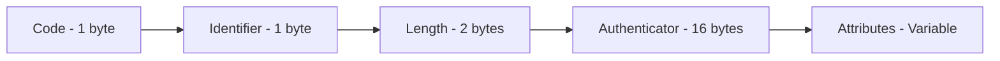

# RADIUS Packet Handling

This guide covers how to work with RADIUS packets,
attributes, and encoding/decoding in the GoRADIUS
library.

## Packet Structure

RADIUS packets follow the structure defined in
RFC 2865:



### Packet Fields

- **Code**: Identifies the packet type
  (Access-Request, Access-Accept, etc.)
- **Identifier**: Unique identifier for matching
  requests and responses
- **Length**: Total length of the packet in bytes
- **Authenticator**: 16-byte field for authentication
  and integrity
- **Attributes**: Variable-length attribute-value
  pairs

## Creating Packets

### Basic Packet Creation

```go
import "go.vitalvas.com/goradius"

// Create a new Access-Request packet
req := goradius.NewPacket(
    goradius.CodeAccessRequest, 1,
)

// Create a response packet
resp := goradius.NewPacket(
    goradius.CodeAccessAccept, req.Identifier,
)
```

### Packet Codes

```go
// Authentication packets
goradius.CodeAccessRequest     // 1
goradius.CodeAccessAccept      // 2
goradius.CodeAccessReject      // 3
goradius.CodeAccessChallenge   // 11

// Accounting packets
goradius.CodeAccountingRequest  // 4
goradius.CodeAccountingResponse // 5

// Status packets
goradius.CodeStatusServer      // 12
goradius.CodeStatusClient      // 13

// Dynamic Authorization (CoA/Disconnect)
goradius.CodeDisconnectRequest // 40
goradius.CodeDisconnectACK     // 41
goradius.CodeDisconnectNAK     // 42
goradius.CodeCoARequest        // 43
goradius.CodeCoAACK           // 44
goradius.CodeCoANAK           // 45
```

## Working with Attributes

### Adding Attributes with Dictionary

The recommended way to work with attributes is using
the dictionary-based API:

```go
import "go.vitalvas.com/goradius"

// Create packet with dictionary
dict, err := goradius.NewDefault()
if err != nil {
    log.Fatal(err)
}
req := goradius.NewPacketWithDictionary(
    goradius.CodeAccessRequest, 1, dict,
)

// Add attributes by name
req.AddAttributeByName(
    "user-name", "john.doe",
)
req.AddAttributeByName(
    "nas-ip-address", "192.168.1.1",
)
req.AddAttributeByName("nas-port", 123)
req.AddAttributeByName(
    "framed-ip-address", "10.0.0.100",
)
req.AddAttributeByName("session-timeout", 3600)

// Tagged attributes use colon notation
req.AddAttributeByName(
    "tunnel-type:1", "vlan",
)
req.AddAttributeByName(
    "tunnel-medium-type:1", "ieee-802",
)
```

### Retrieving Attributes

```go
// Get attribute by name
usernames := req.GetAttribute("user-name")
if len(usernames) > 0 {
    fmt.Printf(
        "Username: %s\n",
        usernames[0].String(),
    )
}

// Get multiple values
replyMessages := req.GetAttribute(
    "reply-message",
)
for _, msg := range replyMessages {
    fmt.Printf("Reply: %s\n", msg.String())
}

// Get vendor attribute by name
dnsServers := req.GetAttribute(
    "erx-primary-dns",
)
if len(dnsServers) > 0 {
    fmt.Printf(
        "Primary DNS: %s\n",
        dnsServers[0].String(),
    )
}

// Get tagged attributes
tunnelTypes := req.GetAttribute("tunnel-type")
for _, tunnelType := range tunnelTypes {
    if tunnelType.Tag > 0 {
        fmt.Printf(
            "Tunnel Type (Tag %d): %s\n",
            tunnelType.Tag,
            tunnelType.String(),
        )
    }
}

// List all attribute names in the packet
attrNames := req.ListAttributes()
for _, name := range attrNames {
    fmt.Printf("Attribute: %s\n", name)
}
```

### Working with Attribute Values

The dictionary API automatically handles encoding
and decoding based on attribute type:

```go
// AttributeValue provides type-safe access
attrs := req.GetAttribute("user-name")
if len(attrs) > 0 {
    // String() works for all attribute types
    fmt.Printf(
        "Username: %s\n", attrs[0].String(),
    )

    // Access metadata
    fmt.Printf(
        "Attribute type ID: %d\n",
        attrs[0].Type,
    )
    fmt.Printf(
        "Data type: %s\n", attrs[0].DataType,
    )
    fmt.Printf("Is VSA: %t\n", attrs[0].IsVSA)
}
```

`Decoded` returns the value as its native Go type
(`string`, `uint32`, `net.IP`, `*net.IPNet`,
`time.Time`, `time.Duration`, `[]byte`) according to
the data type. `Children` decodes a TLV, struct, or
EVS container into a map keyed by child name:

```go
for _, v := range req.GetAttribute("framed-ip-address") {
    ip := v.Decoded().(net.IP)
    fmt.Println(ip)
}

for _, v := range req.GetAttribute("cisco-example-tlv") {
    children, err := v.Children()
    if err == nil {
        fmt.Println(children["tlv-name"])
    }
}
```

### Flat Attribute Maps

`GetAttributes` returns the whole packet as a flat
map from attribute name to values. Tagged attributes
are keyed `name:tag`, and container attributes are
expanded so each child appears under its own name.
`SetAttributes` is the mirror image and accepts the
same shape:

```go
flat := req.GetAttributes()
for name, values := range flat {
    for _, v := range values {
        fmt.Printf("%s = %s\n", name, v.String())
    }
}

err := resp.SetAttributes(map[string][]any{
    "reply-message":          {"line one", "line two"},
    "erx-service-activate:1": {"ipoe-parking"},
    "tlv-name":               {"svc"}, // child of a TLV
})
```

`SetAttributesFromStrings` takes the same map with
string values, for input read from configuration or
a policy engine. Enumerated names, decimal integers,
hex octets (with or without `0x`), and the canonical
`ifid` form are converted according to the
dictionary data type:

```go
err := resp.SetAttributesFromStrings(map[string][]string{
    "acct-status-type":  {"start"},
    "session-timeout":   {"3600"},
    "class":             {"0xdeadbeef"},
    "framed-ip-address": {"192.0.2.10"},
})
```

### Removing Attributes

```go
// All instances by name
removed := pkt.RemoveAttributeByName("reply-message")

// Only the instances carrying tag 1
pkt.RemoveAttributeByName("erx-service-activate:1")
```

## Standard Attributes

Standard attributes are addressed by their lowercase
dictionary name (`user-name`, `framed-ip-address`,
`acct-status-type`). The library does not export a
constant per attribute type; look the numeric type up
in the dictionary when needed:

```go
def, ok := dict.LookupStandardByName("user-name")
// def.ID == 1
```

Only the two types the packet layer handles itself
are exported as constants:

```go
goradius.AttributeTypeVendorSpecific       // 26
goradius.AttributeTypeMessageAuthenticator // 80
```

### Length Constants

```go
goradius.PacketHeaderLength         // 20
goradius.MinPacketLength            // 20
goradius.MaxPacketLength            // 4096
goradius.AuthenticatorLength        // 16
goradius.AttributeHeaderLength      // 2
goradius.VendorSpecificHeaderLength // 6
goradius.MaxAttributeValueLength    // 253
goradius.MaxVSAValueLength          // 247
goradius.MaxUserPasswordLength      // 128
goradius.MaxAttributeTag            // 0x1F
```

### Example Usage with Dictionary

```go
// Create packet with dictionary
dict, err := goradius.NewDefault()
if err != nil {
    log.Fatal(err)
}
req := goradius.NewPacketWithDictionary(
    goradius.CodeAccessRequest, 1, dict,
)

// User credentials
req.AddAttributeByName(
    "user-name", "john.doe",
)
req.AddAttributeByName(
    "user-password", "secret123",
) // Will be encrypted automatically

// NAS information
req.AddAttributeByName(
    "nas-ip-address", "192.168.1.1",
)
req.AddAttributeByName("nas-port", 123)
req.AddAttributeByName(
    "nas-identifier", "nas-gateway-01",
)

// Session information
req.AddAttributeByName(
    "framed-ip-address", "10.0.0.100",
)
req.AddAttributeByName(
    "session-timeout", 3600,
)

// Accounting
req.AddAttributeByName(
    "acct-status-type", "start",
) // Uses enumerated value
req.AddAttributeByName(
    "acct-input-octets", 1024000,
)
req.AddAttributeByName(
    "acct-output-octets", 2048000,
)
```

## Vendor-Specific Attributes

### Adding VSAs with Dictionary

The recommended way to work with vendor-specific
attributes is using the dictionary API:

```go
// Add vendor attributes by name
req.AddAttributeByName(
    "erx-primary-dns", "8.8.8.8",
)
req.AddAttributeByName(
    "erx-secondary-dns", "8.8.4.4",
)

// Tagged vendor attributes use colon notation
req.AddAttributeByName(
    "erx-service-activate:1", "ipoe-parking",
)
req.AddAttributeByName(
    "erx-service-activate:2",
    "svc-ipoe-policer(52428800, 52428800)",
)

// The library automatically:
// - Looks up the vendor ID (e.g., 4874 for ERX)
// - Encodes the VSA with proper structure
// - Handles tagging if the attribute supports it
```

### Retrieving VSAs

Use the high-level dictionary API to retrieve vendor
attributes by name:

```go
// Get vendor attribute by name
dnsServers := req.GetAttribute(
    "erx-primary-dns",
)
if len(dnsServers) > 0 {
    fmt.Printf(
        "Primary DNS: %s\n",
        dnsServers[0].String(),
    )

    // Access VSA metadata if needed
    fmt.Printf(
        "Vendor ID: %d\n",
        dnsServers[0].VendorID,
    )
    fmt.Printf(
        "Vendor Type: %d\n",
        dnsServers[0].VendorType,
    )
}

// Get all vendor attributes
services := req.GetAttribute(
    "erx-service-activate",
)
for _, svc := range services {
    if svc.Tag > 0 {
        fmt.Printf(
            "Service (Tag %d): %s\n",
            svc.Tag, svc.String(),
        )
    } else {
        fmt.Printf(
            "Service: %s\n", svc.String(),
        )
    }
}

// List all attributes including VSAs
attrNames := req.ListAttributes()
for _, name := range attrNames {
    fmt.Printf("Attribute: %s\n", name)
}
```

## Low-Level Attribute API

The raw API works on wire bytes and needs no
dictionary. Prefer the dictionary API above; use these
when a definition is missing or when building test
fixtures.

### Raw Attributes

```go
// Standard attribute: type 18 (Reply-Message)
attr := goradius.NewAttribute(18, []byte("hello"))
req.AddAttribute(attr)

// Tagged attribute (RFC 2868): the tag becomes the
// first value octet
tagged := goradius.NewTaggedAttribute(
    64, 1, []byte{0, 0, 0, 13},
)
req.AddAttribute(tagged)

value := tagged.GetValue() // without the tag octet
```

### Raw Vendor Attributes

```go
va := goradius.NewVendorAttribute(
    4874, 4, net.ParseIP("8.8.8.8").To4(),
)
taggedVA := goradius.NewTaggedVendorAttribute(
    4874, 1, 1, []byte("ipoe-parking"),
)

// Append as a Vendor-Specific attribute (type 26).
// The packet dictionary supplies the vendor header
// widths when it knows the vendor.
attr := req.AddVendorAttribute(va)

// Or build the type 26 attribute yourself
attr = va.ToVSA()           // 1-octet type and length
attr = va.ToVSAFormat(2, 1) // 2-octet vendor type

// Read back by vendor ID and vendor type
first, ok := req.GetVendorAttribute(4874, 4)
all := req.GetVendorAttributes(4874, 4)

// Parse a type 26 attribute
va, err := goradius.ParseVSA(attr)
va, err = goradius.ParseVSAFormat(attr, 2, 1)
```

`ParseVSA` and `ParseVSAFormat` return the first
sub-attribute when a VSA carries several; the packet
accessors return all of them. Tag detection needs the
dictionary, so the parsed `Tag` is always zero.

### Raw Extended Attributes (RFC 6929)

```go
// Short extended attribute: base type 241,
// extended type 1
attr, err := goradius.NewExtendedAttribute(
    241, 1, []byte("hello"),
)
extType, value, err := goradius.ParseExtendedAttribute(attr)

// Long extended attribute: fragmented over base
// type 245 with the More bit set on all but the last
attrs, err := goradius.NewLongExtendedAttributes(
    245, 1, longValue,
)
for _, a := range attrs {
    req.AddAttribute(a)
}

// Extended-Vendor-Specific: vendor 9, vendor type 1
evs, err := goradius.NewEVSAttribute(
    241, 9, 1, []byte("svc"),
)
vendorID, vendorType, value, err := goradius.ParseEVS(evs)
```

`IsExtendedBaseType` and `IsLongExtendedBaseType`
classify a standard type. The wire-format constants
are `ExtendedTypeMin` and `ExtendedTypeMax` (241 to
246), `LongExtendedTypeMin` and `LongExtendedTypeMax`
(245 to 246), `ExtendedIDShift` (256),
`EVSExtendedType` (26), `ExtendedHeaderLength`,
`LongExtendedHeaderLength`,
`MaxShortExtendedValueLength`,
`MaxLongExtendedValueLength`, and
`LongExtendedMoreBit`.

## Packet Encoding and Decoding

### Encoding Packets

**Note: When using the server, encoding is handled
automatically. This section describes low-level
packet operations for advanced use cases.**

```go
// Create packet with dictionary
dict, err := goradius.NewDefault()
if err != nil {
    log.Fatal(err)
}
req := goradius.NewPacketWithDictionary(
    goradius.CodeAccessRequest, 1, dict,
)

// Add attributes using dictionary API
req.AddAttributeByName(
    "user-name", "john.doe",
)
req.AddAttributeByName(
    "nas-ip-address", "192.168.1.1",
)

// Generate random authenticator
rand.Read(req.Authenticator[:])

// Encode packet to bytes
data, err := req.Encode()
if err != nil {
    log.Fatal("Failed to encode:", err)
}

fmt.Printf("Encoded packet: %x\n", data)
```

### Decoding Packets

**Note: When using the server, decoding is handled
automatically and packets are provided with a
dictionary already attached.**

```go
// Decode packet from bytes
pkt, err := goradius.Decode(data)
if err != nil {
    log.Fatal("Failed to decode:", err)
}

// Attach dictionary for attribute access
dict, err := goradius.NewDefault()
if err != nil {
    log.Fatal(err)
}
pkt.Dict = dict

// Now you can use dictionary API
usernames := pkt.GetAttribute("user-name")
if len(usernames) > 0 {
    fmt.Printf(
        "Username: %s\n",
        usernames[0].String(),
    )
}
```

### Value Codecs

`EncodeValue` and `DecodeValue` convert between Go
values and wire bytes for any scalar data type. The
dictionary API calls them for you; they are exposed
for raw attributes:

```go
raw, err := goradius.EncodeValue(3600, goradius.DataTypeInteger)
v, err := goradius.DecodeValue(raw, goradius.DataTypeInteger)
timeout := v.(uint32)
```

Per-type functions are available as well:
`EncodeString`/`DecodeString`,
`EncodeInteger`/`DecodeInteger`,
`EncodeByte`/`DecodeByte`, `EncodeShort`/`DecodeShort`,
`EncodeInteger64`/`DecodeInteger64`,
`EncodeSigned`/`DecodeSigned`,
`EncodeIPAddr`/`DecodeIPAddr`,
`EncodeIPv6Addr`/`DecodeIPv6Addr`,
`EncodeIPv6Prefix`/`DecodeIPv6Prefix`,
`EncodeComboIP`/`DecodeComboIP`, `EncodeIfID`/`DecodeIfID`,
`EncodeDate`/`DecodeDate`,
`EncodeTimeDelta`/`DecodeTimeDelta`, and
`EncodeOctets`/`DecodeOctets`.

### Packet Validation

```go
// Validate packet structure
if err := req.IsValid(); err != nil {
    log.Printf("Invalid packet: %v", err)
}

// Check packet code
if !req.Code.IsValid() {
    log.Printf("Invalid packet code")
}

// Classify the code
req.Code.IsRequest() // Access-Request, Accounting-Request, ...
req.Code.IsReply()   // Access-Accept, CoA-ACK, ...

// Validate packet length
if req.Length < goradius.MinPacketLength ||
    req.Length > goradius.MaxPacketLength {
    log.Printf(
        "Invalid packet length: %d",
        req.Length,
    )
}
```

### Authenticator Calculation

**Note: These methods are marked INTERNAL and should
not be used in application code. The server layer
handles authenticator calculation automatically.**

For advanced use cases requiring direct authenticator
manipulation, these low-level methods are available
but discouraged:

- `CalculateRequestAuthenticator()` - INTERNAL
- `CalculateResponseAuthenticator()` - INTERNAL
- `SetAuthenticator()` - INTERNAL

When using the server, authenticators are calculated
and validated automatically.

### Request/Response Matching

When using the server, responses are automatically
created with matching identifiers:

```go
// In your handler
func (h *myHandler) ServeRADIUS(
    req *goradius.Request,
) (goradius.Response, error) {
    // NewResponse automatically matches
    // the request identifier
    resp := goradius.NewResponse(req)

    // Set response code and attributes
    resp.SetCode(goradius.CodeAccessAccept)
    resp.SetAttribute(
        "reply-message", "Access granted",
    )

    // Authenticators are calculated automatically
    return resp, nil
}
```

### Packet Information

```go
// Get packet size
fmt.Printf(
    "Packet size: %d bytes\n", req.Length,
)

// Count attributes
fmt.Printf(
    "Number of attributes: %d\n",
    len(req.Attributes),
)

// Print packet info
fmt.Println(req.String())
// Output: Code=Access-Request(1), ID=1,
// Length=40, Attributes=2
```

## Packet Security

### Transparent Encryption and Decryption

Attribute encryption and decryption are fully
transparent. The dictionary declares the encryption
type (User-Password per RFC 2865, Tunnel-Password
per RFC 2868, or Ascend-Secret) on the attribute
definition, and the packet derives the correct
keying authenticator from its own type: its random
Request Authenticator for Access-Request, sixteen
zero octets for Accounting/CoA/Disconnect requests,
and the authenticator of the request being answered
for responses. No encryption or decryption call ever
appears in application code.

Encryption happens automatically when the packet is
serialized (`Encode`, Message-Authenticator, and
authenticator calculations):

```go
pkt := goradius.NewPacketWithDictionary(
    goradius.CodeAccessRequest, 1, dict,
)
pkt.Secret = []byte("testing123")
pkt.AddAttributeByName("user-password", "secret123")
pkt.SetAuthenticator(authenticator)

data, err := pkt.Encode() // encrypted on the wire
```

Decryption happens automatically when reading
attributes, as long as the packet `Secret` is set:

```go
pkt.Secret = secret
values := pkt.GetAttribute("user-password")
password := values[0].String() // plaintext
```

This also covers responses. The server pipeline and
`NewResponse` bind the request authenticator to the
reply, so handler code just sets attributes (for
example MPPE keys) and they are encrypted on send.
The `Client` binds it to received responses, so
`resp.GetAttribute("ms-mppe-send-key")` returns the
plaintext key.

`Encode` refuses to serialize a packet whose
encrypted attributes cannot be finalized (for
example when no `Secret` is set), so plaintext
passwords cannot leak onto the wire.

**Note:** `EncryptAttributes()`,
`EncryptAttributeValue()`, and
`DecryptAttributeValue()` remain available as
low-level escape hatches for raw values handled
outside the packet API; application code does not
need them.

### Message-Authenticator

The server and client add and verify the
Message-Authenticator attribute (RFC 2869 Section
5.14) automatically. For packets built outside them:

```go
// Request: keyed by the packet's own authenticator
pkt.AddMessageAuthenticator(secret, pkt.Authenticator)
ok := pkt.VerifyMessageAuthenticator(secret, pkt.Authenticator)

// Response: keyed by the request authenticator
resp.AddMessageAuthenticator(secret, req.Authenticator)
ok = resp.VerifyMessageAuthenticator(secret, req.Authenticator)
```

`AddMessageAuthenticator` replaces any existing
instance, so the packet never carries a stale
duplicate. `VerifyMessageAuthenticator` returns false
when the attribute is absent.

### CHAP

Helpers for CHAP authentication (RFC 2865 Section
2.2). The CHAP-Password value is one identifier octet
followed by the 16-octet MD5 response:

```go
// Client side: build the CHAP-Password
challenge, err := goradius.GenerateCHAPChallenge(
    goradius.CHAPChallengeLength,
)
chapPassword := goradius.GenerateCHAPResponse(
    identifier, []byte("secret123"), challenge,
)
req.AddAttributeByName("chap-password", chapPassword)
req.AddAttributeByName("chap-challenge", challenge)

// Server side: verify against the stored password
chap := req.GetAttribute("chap-password")
chal := req.GetAttribute("chap-challenge")
if len(chap) > 0 && len(chal) > 0 {
    ok := goradius.CheckCHAPPassword(
        chap[0].Value, storedPassword, chal[0].Value,
    )
}
```

When the request carries no CHAP-Challenge attribute,
the Request Authenticator is the challenge (RFC 2865
Section 5.3).
